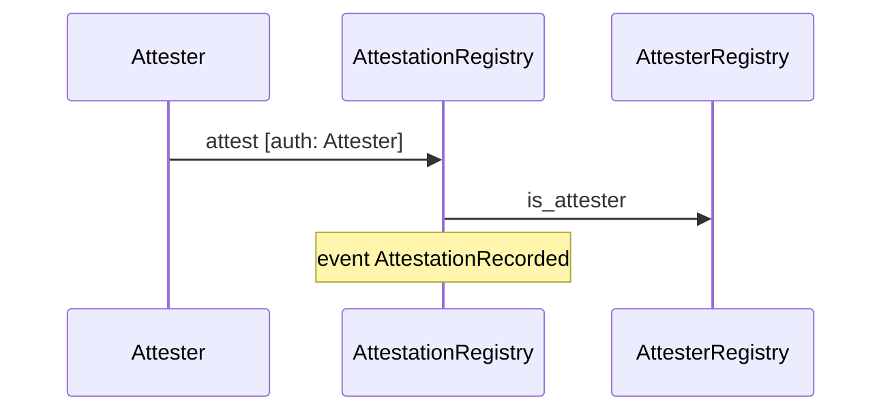
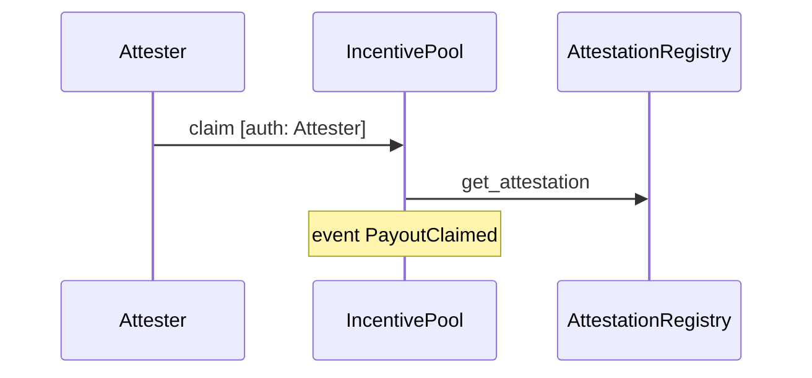
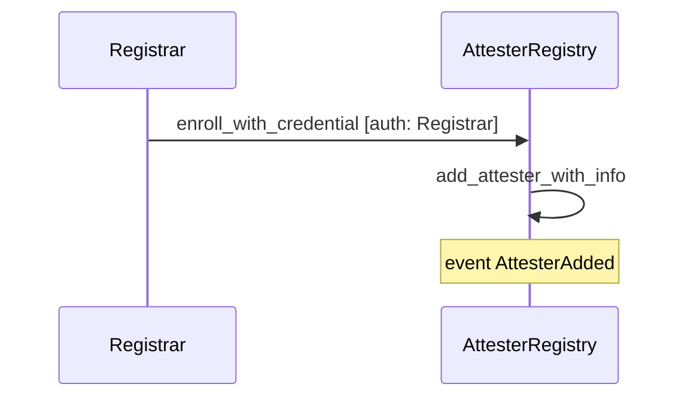
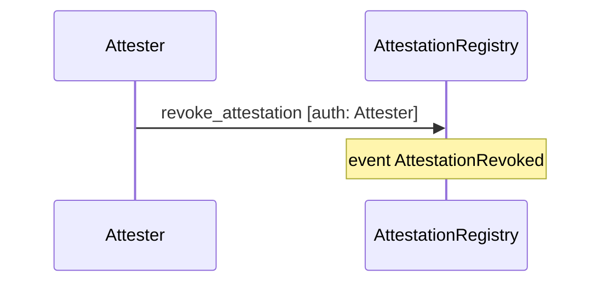
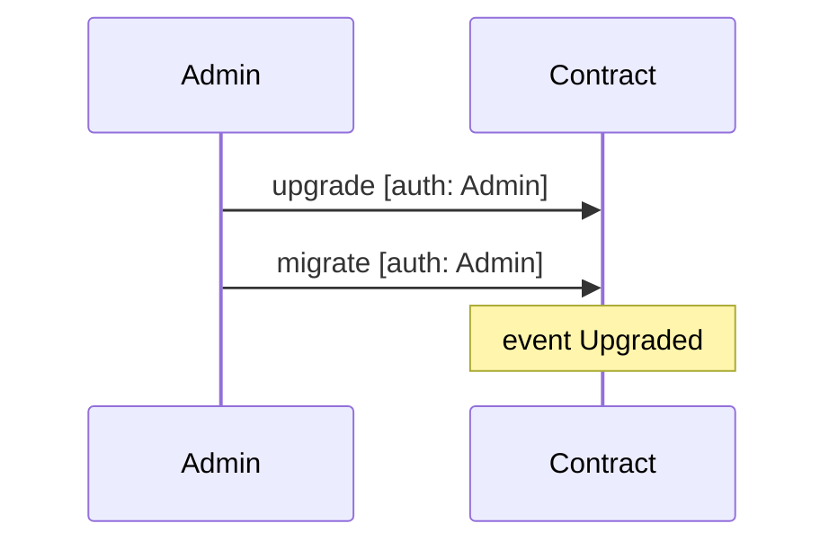

# Sequence diagrams

<!-- GENERATED by scripts/gen_sequence_diagrams.py from docs/architecture/traces/*.json. Do not edit. -->

## Attest a record

## Claim an incentive payout

## Enroll an attester with a licence credential

## Revoke an attestation

## Upgrade a contract

