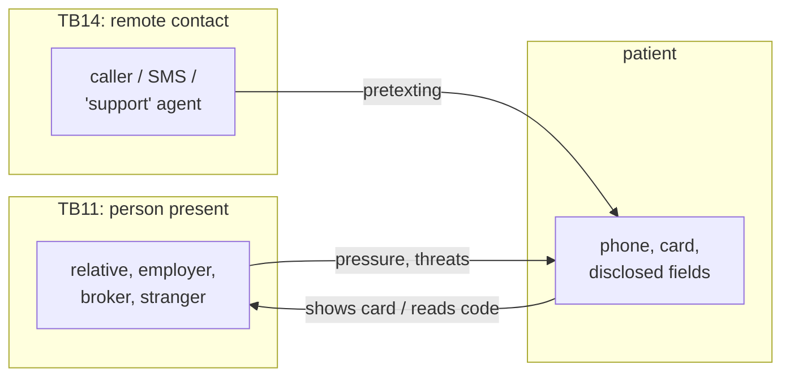
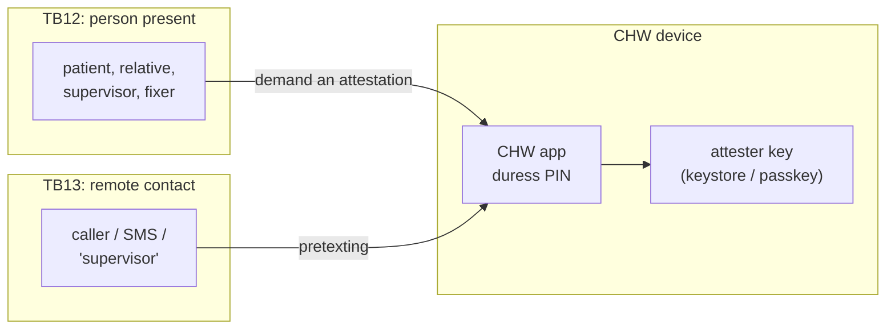

# Coercion and Social-Engineering Threat Model (Patients and CHWs)

The [contract-layer](threat-model.md) and [off-chain](threat-model-offchain.md)
models cover what the code enforces. Neither covers the person holding the
phone or the card. This document models **coercion** (someone forces a patient
or a Community Health Worker, CHW, to act) and **social engineering** (someone
talks them into acting) against the field workflow.

Every threat below has an id (`T-2xx`) in
[`security/threats.yaml`](../../security/threats.yaml) and is listed in the
tables here. `scripts/check_threat_traceability.py` fails if a pointer stops
resolving or if a threat cited here is missing from the registry.

Status labels match the other models: **mitigated**, **partial** (a control
exists, the named gap is open), **open**, **accepted** (with a rationale).

## 1. Trust boundaries

The numbering continues from the off-chain model (TB1–TB10):

| Boundary | Between |
| --- | --- |
| TB11 | The patient and the person physically present with them (family, employer, broker, stranger) |
| TB12 | The CHW and the person physically present with them (patient, relative, supervisor, fixer) |
| TB13 | The CHW and whoever contacts them remotely (caller, SMS/WhatsApp sender, "support" agent) |
| TB14 | The patient and whoever contacts them remotely about their record or card |

TB11–TB14 are **human** boundaries. No contract check can cross them: the
signature is valid because the key holder really did sign, and the card is
genuine because it really was issued. Controls here are procedural, UI-level,
and detective (alerts, review, reinstatement), not preventive at the ledger.

## 2. Assets

| # | Asset | Why it matters |
| --- | --- | --- |
| P1 | Patient safety and privacy | A coerced disclosure can expose HIV status, pregnancy, or location. |
| P2 | Attestation integrity under duress | A coerced CHW signs a false attestation that a responder then trusts. |
| P3 | CHW key and device | The key is the CHW's identity; handing it over is handing over the licence. |
| P4 | CHW physical safety | The control must never make the CHW less safe for refusing. |
| P5 | Programme reputation and trust | A single coerced false "verified" erodes the whole registry. |

## 3. Owners

`owner` in the registry is the accountable maintainer for each component. All
entries currently map to the CODEOWNERS default, `@Coredevjay`, pending the
per-area owners in #238.

## 4. Threats

### 4.1 Patient under coercion or deception

| Id | STRIDE | Threat | Status |
| --- | --- | --- | --- |
| T-201 | I | A person present forces the patient to disclose the card or the QR payload | partial: disclosure is patient-chosen per field, but nothing in the card flow supports refusing under pressure |
| T-202 | S | A third party presents a patient's card as their own to a responder | partial (#389): commitment recomputation stops forgery, a cloned card still verifies |
| T-203 | S | A caller or SMS poses as programme support and asks the patient to read out a code or install an app | open: no published patient-facing guidance and no in-app warning |
| T-204 | T | A patient is persuaded to hand over their phone mid-verification so the "helper" completes it | open: the verdict screen has no guidance on who should hold the device |

### 4.2 CHW under coercion or deception

| Id | STRIDE | Threat | Status |
| --- | --- | --- | --- |
| T-211 | S | A CHW is forced to sign an attestation for a person they did not verify | partial: duress PIN raises a silent supervisor alert, but `self_suspend` is unshipped |
| T-212 | S | A CHW is forced to hand over the device or the key so the attacker signs directly | partial: keys are keystore-wrapped and passkey-gated, but a coerced unlock defeats both |
| T-213 | S | A caller poses as a supervisor or support agent and asks the CHW to re-enrol, rotate, or "test" a signature | open: no callback-verification rule and no in-app warning |
| T-214 | T | A CHW is tricked into attesting for a look-alike identity (right name, wrong person) | partial: the commitment binds disclosed fields, but identity documents are checked by eye only |
| T-215 | R | A CHW is pressured to deny having issued an attestation, or to claim coercion falsely | accepted: attestations are non-repudiable by design (ADR-0019); disputes go to admin review |

## 5. Mitigations in place

| Control | Where |
| --- | --- |
| Duress PIN: app opens normally, silent supervisor alert, admin suspension under the loss/theft SLA | [chw-key-custody.md §5](chw-key-custody.md#5-coercion-duress) |
| Reinstatement after duress is admin-only, after an in-person check | [chw-key-custody.md §5](chw-key-custody.md#5-coercion-duress) |
| Keys never leave secure hardware; user-presence gate per signature (target model) | [ADR-0019](../adr/0019-chw-attester-key-custody.md) |
| Per-field disclosure: the patient chooses what the card reveals | [qr-payload-v1.md](../specs/qr-payload-v1.md) |
| Commitment recomputation rejects a forged card | T-141, T-143, T-144 in the off-chain model |
| `fallback_url` is display-only and never parsed | T-142 in the off-chain model |
| Verdict wording that never says "verified" for a degraded result | T-134 in the off-chain model |

## 6. Gaps to track

Each partial or open threat names its gap in the registry. The registry's
`issue: "to-file: …"` is replaced with the issue number once filed:

| Threat | Proposed issue |
| --- | --- |
| T-201 | Patient-facing "refuse under pressure" guidance and a card flow that supports it |
| T-203 | Published patient guidance on support impersonation, plus an in-app warning |
| T-204 | Verdict-screen guidance on who should hold the device |
| T-211 | Ship `self_suspend` so the duress PIN suspends without an admin round-trip |
| T-213 | Callback-verification rule for supervisor/support contact, plus an in-app warning |
| T-214 | Second-factor identity check (photo or ID hash) before attesting |

## 7. Review

Every section is reviewed by someone other than the author before this model is
relied on. The reviewer checks that each threat matches the field workflow and
that no coercion path is missing.

| Section | Author | Reviewer | Date |
| --- | --- | --- | --- |
| 4.1 Patient | | | |
| 4.2 CHW | | | |

## Maintenance

- A PR that changes the duress flow, the disclosure model, or the verdict UI
  updates the matching table and registry entry.
- When a gap's issue closes, set the entry to `mitigated` and point
  `code`/`tests` at the fix.
