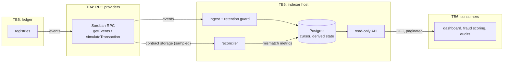
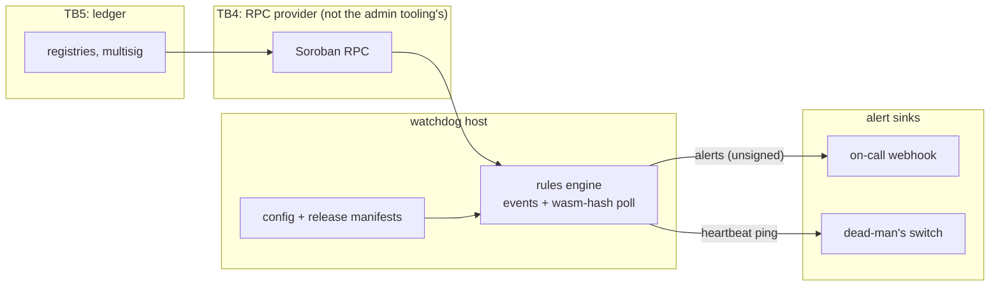
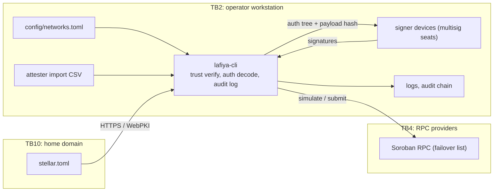
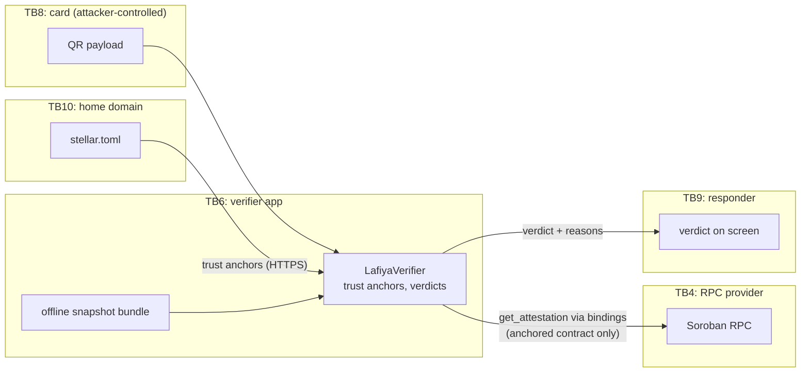
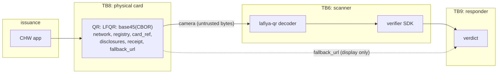
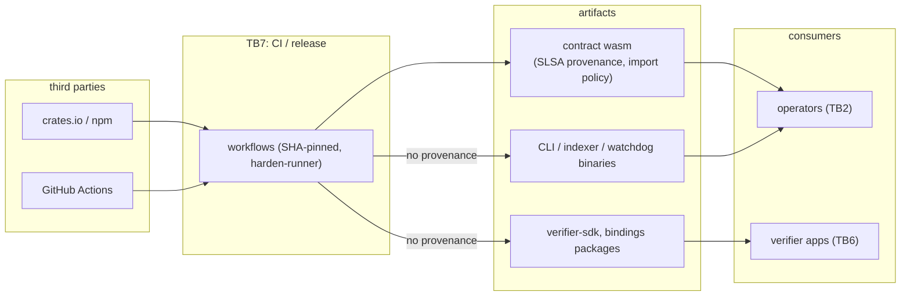

# Off-Chain Threat Model (STRIDE)

The [contract-layer threat model](threat-model.md) covers what Soroban
enforces. Most practical attacks land elsewhere: a poisoned RPC, a malicious
QR code, a spoofed alert, a compromised build. This document models the
off-chain systems in this repository:

| Component | Code |
| --- | --- |
| Indexer | `crates/lafiya-indexer` |
| Watchdog | `crates/lafiya-watchdog` |
| CLI and operator tooling | `crates/lafiya-cli`, `crates/lafiya-rpc-resilience`, `scripts/` |
| Verifier SDK and bindings | `packages/verifier-sdk`, `bindings/`, `crates/lafiya-commitment` |
| QR flow | `crates/lafiya-qr`, `docs/specs/qr-payload-v1.md` |
| Build and distribution | `.github/workflows/`, lockfiles |

Every threat has an id (`T-1xx`) in [`security/threats.yaml`](../../security/threats.yaml).
That entry holds the STRIDE category, the trust boundary, the owner, and
pointers to the code and tests behind the mitigation.
`scripts/check_threat_traceability.py`, run in the Python tooling CI job,
fails if any pointer stops resolving or if a threat cited here is missing
from the registry. Status labels match the contract model. One label is
added: **partial** means a control exists, but the gap named in the registry
is still open.

## 1. Trust boundaries

The numbering continues from the contract model (TB1–TB7):

| Boundary | Between |
| --- | --- |
| TB2 | Operator workstation (CLI, config, signer devices) and everything else |
| TB4 | RPC providers: semi-trusted for availability, **untrusted for integrity** |
| TB5 | The Stellar ledger: the only place integrity is enforced |
| TB6 | Read side: indexer database and API, verifier apps |
| TB7 | CI / release pipeline |
| TB8 | The physical card and its QR code: **attacker-controlled input** |
| TB9 | The responder reading a verdict on screen |
| TB10 | The programme's home domain (`stellar.toml`) and DNS/TLS |

## 2. Assets

| # | Asset | Why it matters |
| --- | --- | --- |
| O1 | Verdict integrity | A responder acts on what the verifier shows. |
| O2 | Admin transaction integrity | One wrong signature can upgrade or repoint a contract. |
| O3 | Alert integrity and liveness | Two-step admin transfer and upgrade review only help if someone notices. |
| O4 | Index fidelity | Dashboards, fraud scoring, and audits read the index, not the ledger. |
| O5 | Operator secrets | Signer seeds and webhook URLs. |
| O6 | Release artifacts | Binaries and packages that operators and apps run. |

## 3. Owners

`owner` in the registry is the accountable maintainer for each component. All
components currently map to the CODEOWNERS default, `@Coredevjay`, pending
the per-area owners in #238. When an area gets its own owner, update the
`owner` fields in the same PR as CODEOWNERS.

## 4. Components

### 4.1 Indexer

| Id | STRIDE | Threat | Status |
| --- | --- | --- | --- |
| T-101 | S, T | A poisoned RPC feeds fabricated or altered events | partial: decode rejects malformed events and the reconciler samples chain state, but through the same provider |
| T-102 | T, D | RPC pruning silently drops history | mitigated (the retention guard fails loudly, and checkpoints resume) |
| T-103 | D | Unbounded queries exhaust the database | mitigated (GET only, page size capped at `MAX_LIMIT`) |
| T-104 | I | The API aggregates linkable record-hash history | accepted (ADR-0001: the data is already public; linkability tracked in #433) |

The indexer is **not** an authority for verification. The verifier SDK reads
the chain (§4.4), so a poisoned index can mislead dashboards and audits but
not a responder.

### 4.2 Watchdog

| Id | STRIDE | Threat | Status |
| --- | --- | --- | --- |
| T-111 | S, R | Spoofed alerts posted to the webhook: fake pages, or a flood that hides a real one | open: payloads are unsigned |
| T-112 | D, R | The watchdog dies or lags, so a privileged event goes unseen | mitigated (lag and failure heartbeat, external dead-man's switch) |
| T-113 | T | A poisoned RPC hides privileged events | partial: a wasm change without an upgrade event is critical, but admin, role, and repoint events are not cross-checked |
| T-114 | T, E | An upgrade to unreviewed wasm looks routine | mitigated (hashes checked against release manifests) |

### 4.3 CLI and operator tooling

| Id | STRIDE | Threat | Status |
| --- | --- | --- | --- |
| T-121 | S | Wrong network or a look-alike contract id | mitigated (`trust verify` against `stellar.toml`, interface kind and version check) |
| T-122 | T, E | Signers approve an opaque or malicious auth tree | mitigated (`auth decode` shows the tree, the payload hash, and token-transfer warnings) |
| T-123 | I | Seeds leak into logs | mitigated (redaction in text and JSON logs) |
| T-124 | R | Operator actions cannot be attributed, or the trail is edited | mitigated (hash-chained audit log and deployment ledger) |
| T-125 | T, E | `config env` output injects shell commands | mitigated (single-quote escaping) |
| T-126 | T, D | An ambiguous timeout causes a duplicate admin transaction | partial: the poll-before-retry state machine exists but is not yet in the CLI submit path |
| T-127 | T | A tampered import CSV enrols the wrong attesters | mitigated (validation, duplicate rejection, diff and plan before signing) |

Key custody for the signer devices is covered by the
[key-generation ceremony](../runbooks/key-ceremony.md).

### 4.4 Verifier SDK and bindings

| Id | STRIDE | Threat | Status |
| --- | --- | --- | --- |
| T-131 | S, T | The QR steers the verifier to an attacker contract or network | mitigated (contracts come only from trust anchors; no chain read on mismatch) |
| T-132 | S, T | A lying RPC returns a fake attestation | open (#390): one provider is trusted for online reads |
| T-133 | T | The SDK and Rust canonicalize a record differently | mitigated (shared LRC-1 vectors, NFC) |
| T-134 | T | The app shows "verified" for an ambiguous result | mitigated (closed verdict set, all reasons in precedence order) |
| T-135 | S | A spoofed `stellar.toml` installs attacker anchors | mitigated (HTTPS from the configured domain, validated anchors) |

### 4.5 QR flow

| Id | STRIDE | Threat | Status |
| --- | --- | --- | --- |
| T-141 | S | A forged or cloned card points at another patient's attested hash | partial (#389): commitment recomputation stops forgery, but a cloned card verifies |
| T-142 | S, I | A phishing link in `fallback_url` | partial: display-only by spec and ignored by the SDK, but no test pins this and apps have no UI guidance |
| T-143 | D | A malformed or oversized QR crashes the scanner | mitigated (typed decode errors, shared negative vectors) |
| T-144 | S | A testnet card is accepted on mainnet | mitigated (network id checked first) |
| T-145 | S, T | A forged or replayed offline receipt | mitigated (signed receipts, snapshot bundle, `maxAgeDays`) |

### 4.6 Build and distribution

| Id | STRIDE | Threat | Status |
| --- | --- | --- | --- |
| T-151 | T, E | A compromised build injects code into off-chain releases | partial: pinned actions and lockfiles, plus provenance and a host-import policy for wasm only |

## 5. Gaps to track

Each partial or open threat names its gap in the registry. Gaps already
tracked: #389 (T-141) and #390 (T-132). The rest need an issue filed, and
the registry's `issue: "to-file: …"` replaced with the issue number:

| Threat | Proposed issue |
| --- | --- |
| T-101 | Indexer reconciles against an independent RPC provider |
| T-111 | Sign watchdog webhook payloads (HMAC) and verify them in the receiver |
| T-113 | Watchdog cross-checks privileged state (admin, roles, registry wiring) against a second provider |
| T-126 | Wire `lafiya-rpc-resilience` into the CLI submit path |
| T-142 | Test and UI guidance for the untrusted `fallback_url` |
| T-151 | SLSA provenance for `lafiya-cli`, indexer, and watchdog binaries and for npm packages |

## 6. Review

Every DFD is reviewed by someone other than the author before this model is
relied on. The reviewer checks that each data flow and boundary matches the
code, and that no component input is missing. The reviewer then records
their handle here in the reviewing PR.

| Section | Author | Reviewer | Date |
| --- | --- | --- | --- |
| 4.1 Indexer | | | |
| 4.2 Watchdog | | | |
| 4.3 CLI and operator tooling | | | |
| 4.4 Verifier SDK and bindings | | | |
| 4.5 QR flow | | | |
| 4.6 Build and distribution | | | |

## Maintenance

- A PR that adds an input, output, or dependency to one of these components
  updates its DFD. A new threat gets a registry entry.
- When a gap's issue closes, set the entry to `mitigated` and point
  `code`/`tests` at the fix. The traceability check enforces the pointers.
